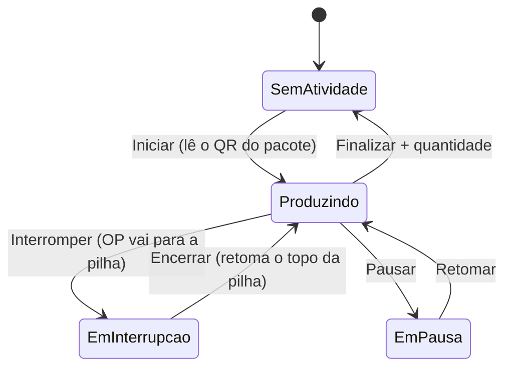
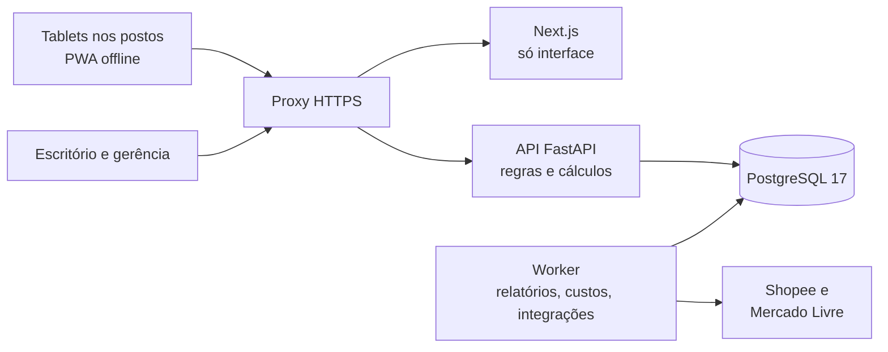
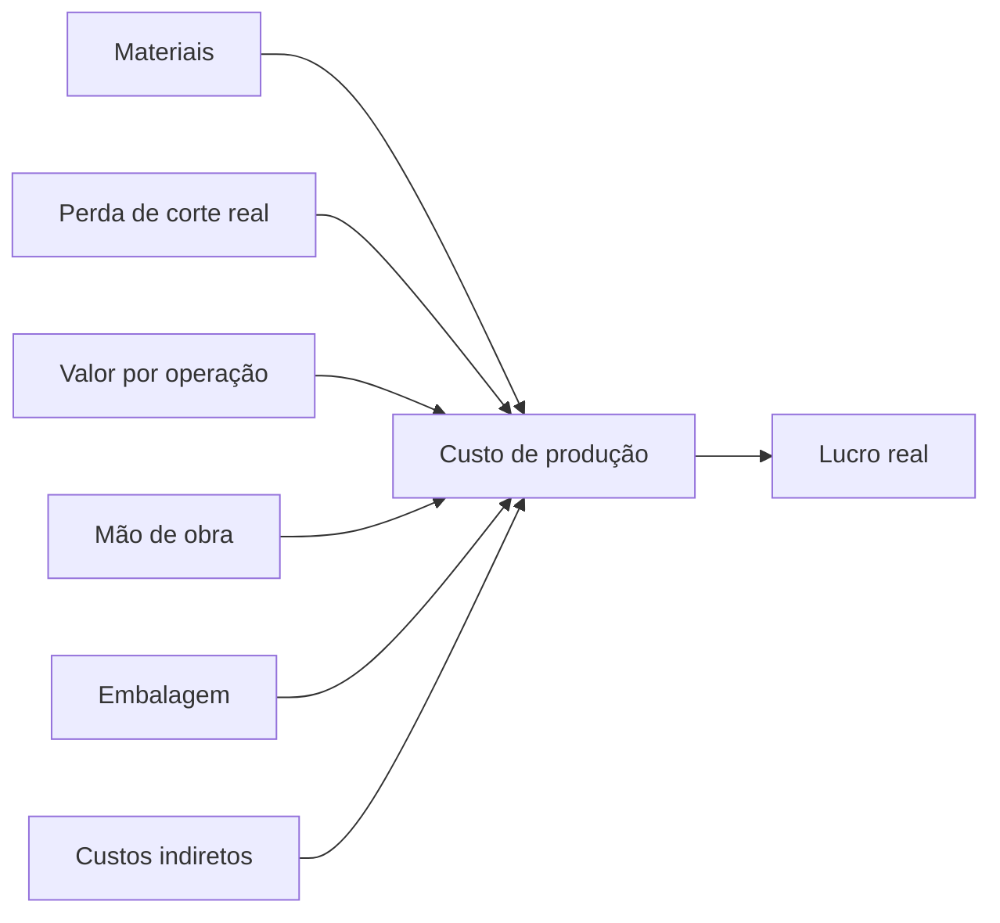

# Meada · Gestão de produção, estoque e custos para uma malharia · Case

Case de um sistema próprio de gestão para uma malharia de roupas de bebê. Ele troca as ordens de produção em papel por OPs digitais, cronometra cada operação no momento em que acontece (incluindo as interrupções) e transforma isso em custo real e lucro real por peça, por OP e por mês.

> 🔒 **Código privado.** O sistema é de uso interno da empresa. Este repositório apresenta o case: problema, solução, arquitetura e decisões técnicas. Nenhum código, dado ou credencial da empresa está publicado aqui. Os números dos exemplos são ilustrativos.

**Meu papel:** desenvolvimento de ponta a ponta, como único desenvolvedor: levantamento com as áreas, plano de implementação, arquitetura, banco de dados, back-end, interface, testes, infraestrutura e documentação. Uso agentes de IA como apoio no desenvolvimento e reviso as decisões técnicas.

**Status:** 🚧 em desenvolvimento. A F3 (estoque, pedidos e urgências) está em andamento; o corte espera decisões. A fundação e o piloto do chão já andam. Este README é atualizado ao fim de cada fase.

---

## 📌 O problema

A malharia usa um ERP têxtil de mercado. Ele atende bem o comercial e o fiscal, mas o modelo de apontamento por fechamento de OP não enxerga o chão de fábrica:

- **Tempo que só aparece depois.** O tempo é registrado quando a OP volta e é encerrada. Não existe acompanhamento em tempo real.
- **Interrupções invisíveis.** A costureira para uma OP para atender outra coisa, e esse trabalho não é contado. Ela parece improdutiva, e a OP parece mais cara do que é.
- **Urgências do e-commerce.** A maior parte das vendas é por marketplaces. Produto vendido sem estoque para a produção programada, e ninguém mede quanto isso custa.
- **Correções que exigem apagar.** Para corrigir um apontamento antigo, é preciso apagar os mais recentes na ordem certa, mesmo os que estavam certos.
- **Travamentos em horário de pico.** Várias pessoas gravando ao mesmo tempo disputam o mesmo registro de totais no banco.
- **Custo e lucro pouco confiáveis.** O custo vem de uma ficha teórica, sem tempo real, perdas de corte nem retrabalho.

## 💡 A solução

| Área | O que o sistema faz |
|---|---|
| OP digital | OP dividida por grade (cor e tamanho) e em pacotes, sem papel. Etiquetas QR reutilizáveis identificam cada pacote. |
| Apontamento | Tablet em cada posto: iniciar, pausar, interromper, retomar e finalizar com um toque. Painel ao vivo para a supervisão. |
| Interrupções | A atividade atual fica suspensa com o tempo parado, a interrupção é cronometrada e custeada, e a OP original volta sozinha no fim. |
| E-commerce | Cada canal tem um adaptador (a peça que fala a língua daquele marketplace). Hoje um canal simulado serve para desenvolver e testar; a Shopee e o Mercado Livre de verdade entram numa decisão ainda aberta. Sem estoque, o item vai para a fila de urgências, que mostra o que já está em produção. |
| Estoque mínimo | Ponto de reposição por SKU (a peça numa cor e num tamanho). A sugestão de produzir é o que falta para o mínimo, já descontando o disponível e o que está em produção. |
| Corte | Previsto na F3: tecido por rolo e lote de tingimento, consumo real, perda real versus prevista. Ainda espera decisões e não entrou. |
| Estoque | Livro de movimentos imutável. O saldo nunca é digitado: é sempre a soma dos movimentos. Produto acabado por SKU; tecido por rolo, com o banho (o lote de tingimento). |
| Custos | Custo padrão (ficha técnica) e custo real (apurado na OP) lado a lado. Encerrar a OP guarda uma fotografia do custo, que não muda se os preços mudarem depois. |
| Financeiro | Contas a pagar e receber, fluxo de caixa e DRE gerencial ligados aos custos da produção. |

## ⏱️ Destaque: apontamento com interrupções

A mudança principal é de modelo: o tempo deixa de ser "início e fim da OP" e vira uma sequência de eventos. No mesmo posto, uma atividade em andamento. Quem cobre outra máquina tem uma tarefa em cada posto.

**Exemplo ilustrativo.** Uma manhã de trabalho que o modelo antigo registraria como 298 minutos numa única OP, com 75% de eficiência. No modelo novo, a mesma manhã mostra 233 minutos na OP, com 96% de eficiência, mais 35 minutos de retrabalho custeados em outra OP, 20 minutos de máquina parada lançados na manutenção e uma pausa de café.

**Decisões importantes:**

- **Uma atividade aberta por posto, garantida pelo banco.** A mesma pessoa pode ter duas, em postos diferentes. Os minutos em que as duas correm juntas se dividem pelo tempo padrão de cada tarefa. O mesmo minuto não conta duas vezes. Duas pessoas na mesma OP é normal: cada uma trabalha num pacote.
- **Nada é apagado.** Eventos só são inseridos. Corrigir ou anular é um novo evento que aponta para o original, com motivo e usuário. Por isso a ordem das correções não importa.
- **Estado derivado.** Os segmentos de tempo e o status de cada pacote são recalculados a partir dos eventos. O status vem das quantidades boas por operação do roteiro, nunca do "último registro".
- **Funciona sem internet.** O tablet guarda os eventos numa fila local e envia tudo quando a conexão volta. Cada evento tem um identificador gerado no próprio aparelho, então reenviar não duplica nada.
- **Tempo real sem consultas a cada segundo.** O painel recebe o início do segmento pela API e calcula o cronômetro localmente.

## 🏗️ Arquitetura

Monólito modular: um back-end com módulos de fronteiras claras e um front-end. Para um desenvolvedor sozinho, é a arquitetura com menos peças para manter.

| Camada | Tecnologias |
|---|---|
| Interface | Next.js, TypeScript estrito, Tailwind CSS, shadcn/ui, TanStack Query e Table, PWA |
| Back-end | Python, FastAPI, Pydantic v2, SQLAlchemy 2, Alembic |
| Fila | Procrastinate, com a fila no próprio PostgreSQL |
| Banco | PostgreSQL 17 |
| Tempo real | Server-Sent Events a partir de `LISTEN/NOTIFY` |
| Relatórios | ReportLab (PDF) e openpyxl (Excel) |
| Execução | Docker e Docker Compose, Caddy como proxy HTTPS |
| Qualidade | pytest, Hypothesis, Testcontainers, Playwright, Ruff, mypy estrito, ESLint, gitleaks |

**Princípios:**

- **Regra de negócio só na API Python.** O front-end exibe e coleta dados. O custo de uma peça é calculado de um só jeito.
- **PostgreSQL padrão e portátil.** Nada depende de recurso exclusivo de provedor, e toda mudança de banco é uma migração versionada. Trocar de banco gerenciado para servidor próprio é trocar uma variável de ambiente.
- **Sem contadores quentes.** Nenhuma linha de totais é atualizada a cada lançamento: totais são somados dos fatos ou consolidados pelo worker. Isso elimina a principal causa dos travamentos do sistema antigo.
- **Concorrência pensada.** Transações curtas, bloqueio por pessoa (nunca por OP), linhas sempre travadas na mesma ordem e nova tentativa automática em caso de conflito.
- **Dinheiro em decimal exato**, com uma regra de arredondamento única aplicada por operação antes de somar.

## 💰 Custeio da peça

Cada peça acumula custo conforme passa pelas operações:

- **Custo padrão e custo real lado a lado**, e a diferença mostra de onde veio (mais perda no corte, retrabalho, tempo acima do padrão).
- **Fotografia do custo:** a OP encerrada guarda o custo apurado, que não muda se os preços mudarem depois.
- **Tributos com vigência**, por causa da reforma tributária: cada alíquota tem data de início e fim.
- **Indiretos rateados por minuto-padrão**, recalculados todo mês com os gastos reais.

## 🔐 Segurança

- Autenticação na própria API: senhas com Argon2id e sessões em cookie `HttpOnly`, `Secure` e `SameSite`.
- MFA obrigatório para financeiro, custos e administradores.
- No chão de fábrica, a costureira entra com um código e um PIN. Tablets cadastrados, com token próprio e bloqueio remoto.
- Papéis e permissões granulares: custos e margens só para quem precisa.
- Auditoria só com inserção, com hash encadeado para tornar adulteração detectável.
- Usuários de banco separados para aplicação, leitura e migração.
- Nenhum segredo no repositório, com verificação automática antes de cada commit e no CI.
- Referência de requisitos: OWASP ASVS nível 2.

## 🗺️ Roadmap

| Fase | Entrega | Status |
|---|---|---|
| F0 | Fundação: repositório, CI/CD, containers, autenticação, papéis, auditoria, decisões de arquitetura | ✅ base pronta |
| F1 | Cadastros, ficha técnica, roteiro de operações, custo padrão | ✅ adiantada |
| F2 | OP digital, QR, tablet com interrupções, modo offline, painel ao vivo; piloto em uma célula. Neste ciclo: parte da caixa, posto ocupado e o trabalho que saiu do posto | ✅ adiantada |
| F3 | Corte, estoque, integração com os canais, fila de urgências, estoque mínimo | 🚧 em andamento; o corte espera decisões |
| F4 | Custo real, financeiro, DRE gerencial, teste de invasão | ⏳ o custo real da OP já entra; o financeiro ainda não |
| F5 | Banco reserva ensaiado, testes de carga, migração final | ⏳ planejada |

## 🧭 Como o projeto é conduzido

- **Plano antes do código:** plano de implementação com diagnóstico, arquitetura, riscos e 20 decisões registradas, cada uma com opções, recomendação e quem decide.
- **Decisões documentadas:** cada decisão fechada vira um ADR no repositório.
- **Fluxo de branches por área:** back, front, infra e docs em branches e Pull Requests separados, revisados numa branch de integração antes de subir para produção.
- **Commits padronizados:** Conventional Commits em português, com gitmoji.
- **Definição de pronto:** testes passando (cobertura mínima de 90% nos módulos de cálculo), permissão e auditoria verificadas, migração compatível com a versão anterior e documentação atualizada.

## 📒 Diário de ciclos

Uma entrada por fase: o que entrou, as decisões e o que ainda espera.

### F0 · Fundação

- Plano de implementação e registro de decisões.
- Repositório organizado em `frontend/` e `backend/`, com pre-commit e verificação de segredos.
- Fluxo de branches e padrão de commits definidos.

### F2 · Piloto do chão (em andamento)

O piloto é uma célula da máquina reta, com as overlocks que trabalham com ela. A caixa vai e volta entre as duas.

- **Duas máquinas.** A costureira pode cobrir outra máquina e ter uma tarefa em cada posto. Os minutos em que as duas correm juntas se dividem pelo tempo padrão de cada tarefa. O mesmo minuto não conta duas vezes.
- **Habilidades.** Sem habilidade cadastrada, a pessoa não recebe processo. No tablet, **Mudar de máquina** aparece quando ela sabe fazer o processo e a máquina atual não serve. Cada tablet mostra só o processo da própria máquina. A tela de entrada diz de qual máquina é o tablet.
- **Lista de OPs por página.** A mais nova primeiro. O andamento fica numa tabela que uma tarefa em segundo plano refaz, em vez de uma linha atualizada a cada finalização. Peças reprovadas no último processo aparecem à parte: a OP pode terminar com menos peças boas do que o corte, e isso não é trabalho faltando.
- **Usuários do escritório.** A pessoa é convidada e cria a própria senha. Quem cadastra só pode dar uma permissão que ele mesmo tem.
- **Páginas.** Cada página recebe um nonce, um código de uso único. Só o script que carrega esse código roda. Conferir o hash do arquivo não bastava: o script que a página usa para acordar muda a cada pedido e não tem hash fixo (ADR 0012).
- **PDF.** O WeasyPrint pedia bibliotecas do sistema operacional. O ReportLab é Python puro e gera o PDF igual em qualquer máquina. São dois arquivos: **Somente os dados**, com as tabelas do Excel, e **Detalhado**, com os números de resumo e os gráficos. As tabelas saem da própria planilha, para o PDF e o Excel mostrarem a mesma coisa (ADR 0013).
- **Volume.** Um ensaio encheu um banco vazio pela própria API: 1 mês com 30 costureiras e 6 meses com 100. Mediu as telas que crescem com o histórico: a lista de OPs, uma OP, os tempos da OP, o dia, a espera, a produção, os alertas, o estoque da peça, a fila de urgências e os pedidos. Nenhuma consulta foi otimizada. Isso fica para depois.

De 20 a 23/11:

- **Parte da caixa.** Finalizar só valia para a caixa inteira. No meio do caminho (outra OP na frente, ou o turno acabando) o que já estava feito não tinha registro próprio. Ela escolhe **Sim, terminei todas** ou **Fiz só parte** e digita quantas fez. As que faltam voltam para a fila dela, já aceitas. O total da tarefa não muda: o processo seguinte só libera quando todas as peças passam.
- **Posto ocupado.** Entrar numa máquina em que outra pessoa estava costurando encerrava a sessão dela e pausava o trabalho, sem aviso. Ela sumia do chão. A entrada agora é recusada. O tablet diz quem está trabalhando e pede que essa pessoa pause ou saia. Só então a outra entra.
- **Fora do posto.** Trabalho pausado que nenhum card de posto mostra (ela saiu, outra pessoa entrou na máquina, ou ela está noutra máquina) sumia do escritório. A seção **Fora do posto com trabalho aberto** mostra o processo, em que máquina ficou e onde ela está agora.
- **Retomar.** **Retomar** aparecia numa máquina que não serve para o processo, e ele voltava na máquina errada. **Retomar** só aparece onde a máquina serve e traz o processo para ela. Onde não serve, aparece **Mudar de máquina**.
- **Lista de OPs em arquivo.** A lista da tela não baixava como os outros relatórios. Excel e PDF seguem os filtros da tela, sem página. O PDF tem **Somente os dados** e **Detalhado**. Os números vêm prontos da API.
- **Teste do piloto.** O teste de ponta a ponta fala com a API de verdade. Passou a cobrir a caixa inteira, a parte da caixa e o posto ocupado. Roda num banco só de teste, separado do banco de desenvolvimento.

### F3 · Estoque, pedidos e urgências (em andamento)

O que já entrou, sem o corte:

- **Produto acabado por SKU.** A caixa entra no estoque quando termina, com as peças boas. O saldo é a soma dos movimentos. Ninguém digita um saldo.
- **Materiais.** Tecido entra por rolo e guarda o banho. Aviamento entra por quantidade. O custo médio é o valor em estoque dividido pela quantidade.
- **Pedidos e reservas.** Um item reserva a quantidade inteira do SKU ou não reserva nada. Enviar tira as peças do estoque. Cancelar devolve a reserva.
- **Urgências.** Item vendido sem estoque aparece na fila, do pedido mais antigo, com o que já está em produção. Dá para abrir uma OP de urgência para uma peça só.
- **Estoque mínimo.** Por SKU. A sugestão de produzir desconta o disponível e o que já está em produção.
- **Ajuste de inventário.** Pede uma segunda pessoa. Quem pediu não aprova. Só a aprovação mexe no estoque.
- **Canais.** Um adaptador por canal. O canal simulado desenvolve e testa o fluxo. A ligação de verdade com a Shopee e o Mercado Livre ainda não está ligada.
- **Custo real da OP.** Sai dos fatos (materiais das peças cortadas, valor das operações, indiretos pelos minutos trabalhados) ao lado do custo padrão. Encerrar guarda a fotografia.
- **Designar a OP.** O escritório entrega de uma vez, a uma costureira, as caixas dos processos escolhidos. Elas aparecem no tablet dela para aceitar.
- **Excel.** Estoque, custo, produção, o dia, pedidos e urgências baixam a mesma fotografia da tela. A planilha não calcula de novo.

Três decisões desta fase:

- **Estoque só de movimentos.** Não existe uma linha de saldo atualizada a cada lançamento. O saldo é sempre a soma. Uma correção entra como movimento novo, para o outro lado.
- **Travar antes de ler.** Antes de decidir se uma caixa já terminou, o sistema trava aquela caixa. Duas finalizações ao mesmo tempo não podem achar, as duas, que são a primeira a lançar a entrada no estoque.
- **Segundo aprovador.** O ajuste de inventário só vale com outra pessoa. Quem pediu não decide. A contagem errada não entra sozinha, e o ajuste não deixa menos peças do que as já prometidas a um pedido.

O corte (rolo na produção, enfesto e perda real) continua esperando decisões. Não entrou.

## 🧠 O que estou aprendendo

- O problema do chão de fábrica é de modelo, não de tecnologia: trocar "início e fim" por eventos resolve interrupções, correções e travamentos de uma vez.
- Restrições no banco são a rede de segurança; as regras e as mensagens claras ficam no domínio, com testes.
- Para um desenvolvedor sozinho, poucas peças bem documentadas valem mais do que uma arquitetura sofisticada.
- Testes que gravam no banco precisam de um banco só deles. No banco compartilhado, um teste lê o que outro deixou.
- Uma regra mais estrita quebra o que foi escrito para a regra antiga. Foi o caso das habilidades: sem cadastro, a pessoa deixou de receber processo, e os geradores de dados e os testes que nasciam sem habilidade passaram a falhar.

Desenvolvido por **[Vitor Boarreto](https://github.com/Boarreto)**.
