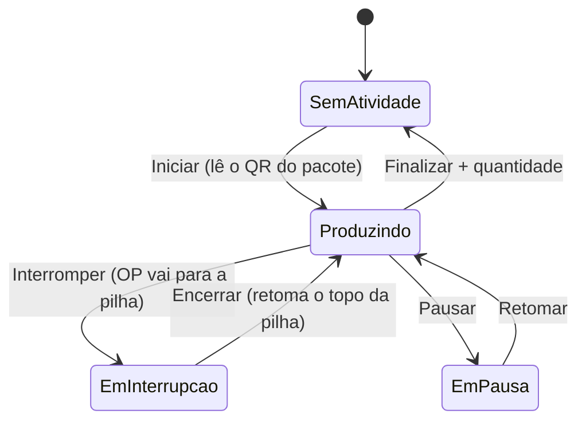
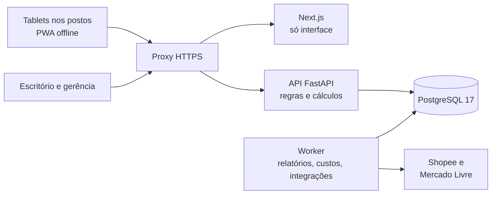
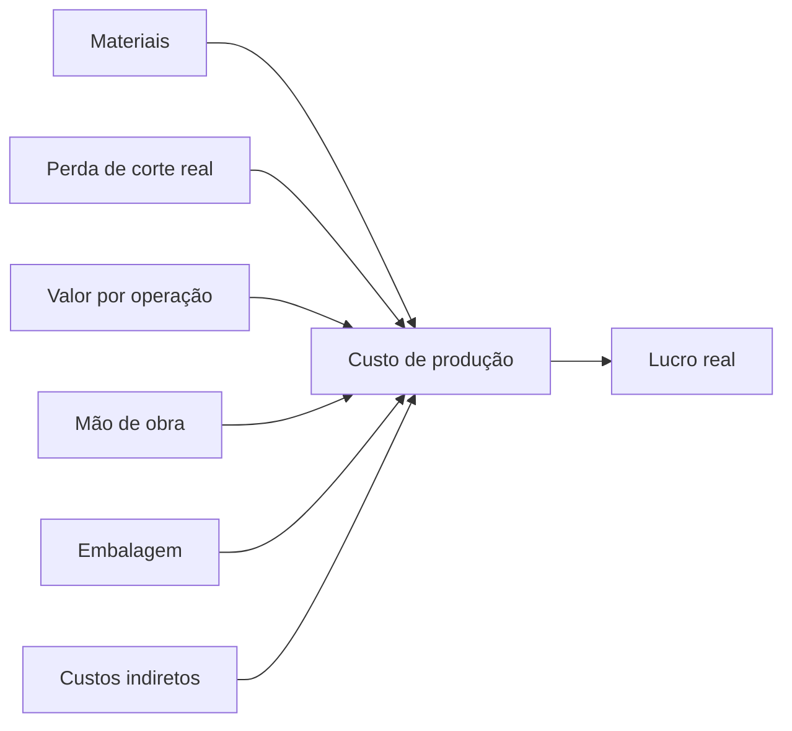

# Meada · Gestão de produção, estoque e custos para uma malharia · Case

Case de um sistema próprio de gestão para uma malharia de roupas de bebê. Ele troca as ordens de produção em papel por OPs digitais, cronometra cada operação no momento em que acontece (incluindo as interrupções) e transforma isso em custo real e lucro real por peça, por OP e por mês.

> 🔒 **Código privado.** O sistema é de uso interno da empresa. Este repositório apresenta o case: problema, solução, arquitetura e decisões técnicas. Nenhum código, dado ou credencial da empresa está publicado aqui. Os números dos exemplos são ilustrativos.

**Meu papel:** desenvolvimento de ponta a ponta, como único desenvolvedor: levantamento com as áreas, plano de implementação, arquitetura, banco de dados, back-end, interface, testes, infraestrutura e documentação. Uso agentes de IA como apoio no desenvolvimento e reviso as decisões técnicas.

**Status:** 🚧 em desenvolvimento, fase F0 (fundação). Este README é atualizado ao fim de cada fase.

---

## 📌 O problema

A malharia usa um ERP têxtil de mercado. Ele atende bem o comercial e o fiscal, mas o modelo de apontamento por fechamento de OP não enxerga o chão de fábrica:

- **Tempo que só aparece depois.** O tempo é registrado quando a OP volta e é encerrada. Não existe acompanhamento em tempo real.
- **Interrupções invisíveis.** A costureira para uma OP para atender outra coisa, e esse trabalho não é contado. Ela parece improdutiva, e a OP parece mais cara do que é.
- **Urgências do e-commerce.** A maior parte das vendas é por marketplaces. Produto vendido sem estoque para a produção programada, e ninguém mede quanto isso custa.
- **Correções que exigem apagar.** Para corrigir um apontamento antigo, é preciso apagar os mais recentes na ordem certa, mesmo os que estavam certos.
- **Travamentos em horário de pico.** Várias pessoas gravando ao mesmo tempo disputam o mesmo registro de totais no banco.
- **Custo e lucro pouco confiáveis.** O custo vem de uma ficha teórica, sem tempo real, perdas de corte nem retrabalho.

## 💡 A solução

| Área | O que o sistema faz |
|---|---|
| OP digital | OP dividida por grade (cor e tamanho) e em pacotes, sem papel. Etiquetas QR reutilizáveis identificam cada pacote. |
| Apontamento | Tablet em cada posto: iniciar, pausar, interromper, retomar e finalizar com um toque. Painel ao vivo para a supervisão. |
| Interrupções | A atividade atual fica suspensa com o tempo parado, a interrupção é cronometrada e custeada, e a OP original volta sozinha no fim. |
| E-commerce | Pedidos da Shopee e do Mercado Livre entram sozinhos. Sem estoque, viram uma fila de urgências que mostra antes se já há peças em produção. |
| Estoque mínimo | Ponto de reposição por SKU, calculado pela velocidade de venda, para reduzir as urgências. |
| Corte | Tecido por rolo e lote de tingimento, consumo real por peso, perda real versus prevista. |
| Estoque | Livro de movimentos imutável. O saldo nunca é digitado: é sempre a soma dos movimentos. |
| Custos | Custo padrão (ficha técnica) e custo real (apurado na OP) lado a lado, por operação. |
| Financeiro | Contas a pagar e receber, fluxo de caixa e DRE gerencial ligados aos custos da produção. |

## ⏱️ Destaque: apontamento com interrupções

A mudança principal é de modelo: o tempo deixa de ser "início e fim da OP" e vira uma sequência de eventos. Cada pessoa tem sempre exatamente uma atividade em andamento.

**Exemplo ilustrativo.** Uma manhã de trabalho que o modelo antigo registraria como 298 minutos numa única OP, com 75% de eficiência. No modelo novo, a mesma manhã mostra 233 minutos na OP, com 96% de eficiência, mais 35 minutos de retrabalho custeados em outra OP, 20 minutos de máquina parada lançados na manutenção e uma pausa de café.

**Decisões importantes:**

- **Uma atividade aberta por pessoa, garantida pelo banco.** Uma restrição de exclusão sobre intervalos de tempo impede dois períodos sobrepostos para a mesma pessoa. Duas pessoas na mesma OP é normal: cada uma trabalha num pacote.
- **Nada é apagado.** Eventos só são inseridos. Corrigir ou anular é um novo evento que aponta para o original, com motivo e usuário. Por isso a ordem das correções não importa.
- **Estado derivado.** Os segmentos de tempo e o status de cada pacote são recalculados a partir dos eventos. O status vem das quantidades boas por operação do roteiro, nunca do "último registro".
- **Funciona sem internet.** O tablet guarda os eventos numa fila local e envia tudo quando a conexão volta. Cada evento tem um identificador gerado no próprio aparelho, então reenviar não duplica nada.
- **Tempo real sem consultas a cada segundo.** O painel recebe o início do segmento pela API e calcula o cronômetro localmente.

## 🏗️ Arquitetura

Monólito modular: um back-end com módulos de fronteiras claras e um front-end. Para um desenvolvedor sozinho, é a arquitetura com menos peças para manter.

| Camada | Tecnologias |
|---|---|
| Interface | Next.js, TypeScript estrito, Tailwind CSS, shadcn/ui, TanStack Query e Table, PWA |
| Back-end | Python, FastAPI, Pydantic v2, SQLAlchemy 2, Alembic |
| Fila | Procrastinate, com a fila no próprio PostgreSQL |
| Banco | PostgreSQL 17 |
| Tempo real | Server-Sent Events a partir de `LISTEN/NOTIFY` |
| Relatórios | WeasyPrint (PDF) e openpyxl (Excel) |
| Execução | Docker e Docker Compose, Caddy como proxy HTTPS |
| Qualidade | pytest, Hypothesis, Testcontainers, Playwright, Ruff, mypy estrito, ESLint, gitleaks |

**Princípios:**

- **Regra de negócio só na API Python.** O front-end exibe e coleta dados. O custo de uma peça é calculado de um só jeito.
- **PostgreSQL padrão e portátil.** Nada depende de recurso exclusivo de provedor, e toda mudança de banco é uma migração versionada. Trocar de banco gerenciado para servidor próprio é trocar uma variável de ambiente.
- **Sem contadores quentes.** Nenhuma linha de totais é atualizada a cada lançamento: totais são somados dos fatos ou consolidados pelo worker. Isso elimina a principal causa dos travamentos do sistema antigo.
- **Concorrência pensada.** Transações curtas, bloqueio por pessoa (nunca por OP), linhas sempre travadas na mesma ordem e nova tentativa automática em caso de conflito.
- **Dinheiro em decimal exato**, com uma regra de arredondamento única aplicada por operação antes de somar.

## 💰 Custeio da peça

Cada peça acumula custo conforme passa pelas operações:

- **Custo padrão e custo real lado a lado**, e a diferença mostra de onde veio (mais perda no corte, retrabalho, tempo acima do padrão).
- **Fotografia do custo:** a OP encerrada guarda o custo apurado, que não muda se os preços mudarem depois.
- **Tributos com vigência**, por causa da reforma tributária: cada alíquota tem data de início e fim.
- **Indiretos rateados por minuto-padrão**, recalculados todo mês com os gastos reais.

## 🔐 Segurança

- Autenticação na própria API: senhas com Argon2id e sessões em cookie `HttpOnly`, `Secure` e `SameSite`.
- MFA obrigatório para financeiro, custos e administradores.
- No chão de fábrica: crachá com QR mais PIN curto. Tablets cadastrados, com token próprio, modo quiosque e bloqueio remoto.
- Papéis e permissões granulares: custos e margens só para quem precisa.
- Auditoria só com inserção, com hash encadeado para tornar adulteração detectável.
- Usuários de banco separados para aplicação, leitura e migração.
- Nenhum segredo no repositório, com verificação automática antes de cada commit e no CI.
- Referência de requisitos: OWASP ASVS nível 2.

## 🗺️ Roadmap

| Fase | Entrega | Status |
|---|---|---|
| F0 | Fundação: repositório, CI/CD, containers, autenticação, papéis, auditoria, decisões de arquitetura | 🚧 em andamento |
| F1 | Cadastros, ficha técnica, roteiro de operações, custo padrão | ⏳ planejada |
| F2 | OP digital, QR, tablet com interrupções, modo offline, painel ao vivo; piloto em uma célula | ⏳ planejada |
| F3 | Corte, estoque, integração Shopee e Mercado Livre, fila de urgências, estoque mínimo | ⏳ planejada |
| F4 | Custo real, financeiro, DRE gerencial, teste de invasão | ⏳ planejada |
| F5 | Banco reserva ensaiado, testes de carga, migração final | ⏳ planejada |

## 🧭 Como o projeto é conduzido

- **Plano antes do código:** plano de implementação com diagnóstico, arquitetura, riscos e 20 decisões registradas, cada uma com opções, recomendação e quem decide.
- **Decisões documentadas:** cada decisão fechada vira um ADR no repositório.
- **Fluxo de branches por área:** back, front, infra e docs em branches e Pull Requests separados, revisados numa branch de integração antes de subir para produção.
- **Commits padronizados:** Conventional Commits em português, com gitmoji.
- **Definição de pronto:** testes passando (cobertura mínima de 90% nos módulos de cálculo), permissão e auditoria verificadas, migração compatível com a versão anterior e documentação atualizada.

## 📒 Diário de ciclos

Uma entrada por fase concluída: o que foi entregue, os números e o que aprendi.

### F0 · Fundação (em andamento)

- Plano de implementação e registro de decisões.
- Repositório organizado em `frontend/` e `backend/`, com pre-commit e verificação de segredos.
- Fluxo de branches e padrão de commits definidos.

## 🧠 O que estou aprendendo

- O problema do chão de fábrica é de modelo, não de tecnologia: trocar "início e fim" por eventos resolve interrupções, correções e travamentos de uma vez.
- Restrições no banco são a rede de segurança; as regras e as mensagens claras ficam no domínio, com testes.
- Para um desenvolvedor sozinho, poucas peças bem documentadas valem mais do que uma arquitetura sofisticada.

Desenvolvido por **[Vitor Boarreto](https://github.com/Boarreto)**.
